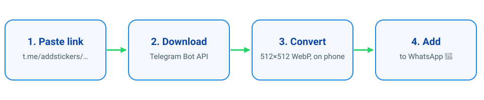

<p align="center">
  
</p>

<p align="center">
  <a href="https://github.com/J4XD/StickerBridge/releases/latest"></a>
  <a href="https://github.com/J4XD/StickerBridge/actions/workflows/build.yml"></a>
  
  
  <a href="LICENSE"></a>
</p>

<p align="center">
  <b>Paste a Telegram sticker pack link and add it to WhatsApp with one tap.</b><br>
  Free • Open source • No ads • No account • No server
</p>

<p align="center">
  🇮🇳 <a href="docs/GUIDE_HINDI.md"><b>Hindi / Hinglish guide yahan padhein</b></a>
</p>

---

## 📑 Contents

- [Features](#-features)
- [Download](#-download)
- [How to use](#-how-to-use)
- [FAQ](#-faq)
- [Troubleshooting](#-troubleshooting)
- [Build from source](#-build-from-source)
- [How it works](#-how-it-works)
- [Contributing](#-contributing)

## ✨ Features

| | Feature | |
|---|---|---|
| 🖼️ | **Static stickers** | Resized to WhatsApp's 512×512 format |
| 🎞️ | **Animated stickers** (`.tgs`) | Converted to animated WebP on your phone |
| 🎬 | **Video stickers** (`.webm`) | Experimental: the background may turn black |
| ✂️ | **Auto-split big packs** | WhatsApp allows max 30 per pack, so a 120-sticker pack becomes 4 packs |
| 📲 | **Share to import** | In Telegram tap *Share* on a pack and pick StickerBridge |
| 💼 | **WhatsApp Business** | Works with both WhatsApp and WhatsApp Business |
| 🔒 | **Private** | No server, no analytics. Your token only ever goes to `api.telegram.org` |

## 📥 Download

1. Go to **[Releases](https://github.com/J4XD/StickerBridge/releases/latest)** and download `StickerBridge-vX.Y.Z.apk`.
2. Open the file on your phone. If Android asks, allow **"Install unknown apps"** for your browser or file manager.
3. Tap **Install**.

> [!NOTE]
> Android 7.0 or newer is required, plus WhatsApp or WhatsApp Business.

## 🚀 How to use

<p align="center"></p>

### Step 1: Get a free Telegram bot token (one time only, ~30 seconds)

1. Open Telegram and search for **[@BotFather](https://t.me/BotFather)** (official, blue tick ✔️).
2. Send `/newbot`.
3. Send any name, e.g. `My Sticker Bot`.
4. Send a username that ends in `bot`, e.g. `mysticker12345_bot`.
5. BotFather replies with a token that looks like this:
   ```
   7012345678:AAH1bCdEfGhIjKlMnOpQrStUvWxYz123456
   ```
6. Copy it, open **StickerBridge** and paste it into **Telegram bot token**. The app remembers it.

> [!TIP]
> **Why is a token needed?** Telegram only allows downloading sticker files through its official
> Bot API. Old converter apps shared one token among all users. When Telegram blocked it, those
> apps stopped working. With your own token, that can't happen.

### Step 2: Copy a sticker pack link

In Telegram, open any sticker pack → tap **⋮** (top right) → **Copy link**.
It looks like `https://t.me/addstickers/PackName`.

*Shortcut:* tap **Share** instead and choose **StickerBridge**. The link is filled in for you.

### Step 3: Import

Paste the link and tap **Import pack**. A progress bar shows each sticker being converted.

### Step 4: Add to WhatsApp

Tap **Add to WhatsApp** under the pack. WhatsApp opens and asks to confirm. Tap **Add**. 🎉

The stickers are now in WhatsApp → 😀 emoji button → sticker tab.

## ❓ FAQ

<details>
<summary><b>Is it free? Are there ads?</b></summary>

Yes, it's 100% free, with no ads and no tracking. It's open source under the MIT license.
</details>

<details>
<summary><b>Is my bot token safe?</b></summary>

The token is stored only on your phone and is sent only to `api.telegram.org`. A bot token
can't read your messages or touch your Telegram account. It only controls the empty bot you created.
If you ever want to, you can revoke it in @BotFather with `/revoke`.
</details>

<details>
<summary><b>Why was my pack split into several packs?</b></summary>

WhatsApp allows a maximum of **30 stickers per pack**, and a pack must be either all static or
all animated. StickerBridge splits packs evenly to follow those rules. For example, 61 stickers become 21 + 20 + 20.
</details>

<details>
<summary><b>Some stickers were skipped. Why?</b></summary>

Video stickers are skipped unless you tick *Include video stickers*. Very complex animations can
also be skipped if they can't be made smaller than WhatsApp's 500 KB limit.
</details>

<details>
<summary><b>Do I need to keep the app installed?</b></summary>

Yes. WhatsApp loads the sticker files from StickerBridge, so if you uninstall the app the packs disappear from WhatsApp.
</details>

<details>
<summary><b>Can I import custom emoji packs (t.me/addemoji/…)?</b></summary>

Yes, those links work too. Custom emoji are small (100×100), so they look a little soft when enlarged.
</details>

## 🛠️ Troubleshooting

| Problem | Fix |
|---|---|
| `Bot token is invalid` | Copy the full token again from @BotFather, including the part before `:` |
| `Sticker pack not found` | Check the link. The pack may have been deleted |
| `WhatsApp is not installed` | Install or update WhatsApp from the Play Store |
| WhatsApp shows *"There's a problem with this sticker pack"* | Update WhatsApp, then delete and re-import the pack. If it persists, [open an issue](https://github.com/J4XD/StickerBridge/issues/new/choose) with the pack link |
| Nothing happens on import / network error | Check your internet. Telegram may be blocked on your network, so try mobile data or Wi‑Fi |
| Can't install an update | Uninstall the old version first (see *signing* below) |

## 🧑‍💻 Build from source

Requirements: **JDK 17+** and the **Android SDK** (Android Studio includes both).

```bash
git clone https://github.com/J4XD/StickerBridge.git
cd StickerBridge
./gradlew assembleRelease
# → app/build/outputs/apk/release/app-release.apk
```

### Automatic builds (GitHub Actions)

- **Every push to `main`:** the APK is attached to the workflow run under *Actions → run → Artifacts*.
- **New release:** bump `versionName` (and `versionCode`) in `app/build.gradle.kts` and push to `main`.
  The workflow publishes the release `v<versionName>` with the APK attached.

### Signing with your own key (recommended)

Without a key, CI signs with a throw-away debug key, so users must uninstall before updating. Create a key once:

```bash
keytool -genkey -v -keystore release.jks -keyalg RSA -keysize 2048 -validity 10000 -alias stickerbridge
base64 -w0 release.jks
```

Then add these under **Settings → Secrets and variables → Actions**:

| Secret | Value |
|---|---|
| `KEYSTORE_BASE64` | output of the `base64` command |
| `SIGNING_STORE_PASSWORD` | keystore password |
| `SIGNING_KEY_ALIAS` | `stickerbridge` |
| `SIGNING_KEY_PASSWORD` | key password |

> [!WARNING]
> Never commit `release.jks`. Keep a backup: if you lose it, you can't ship updates under the same signature.

## ⚙️ How it works

```
app/src/main/java/io/github/stickerbridge/
├── MainActivity.kt                 UI: token, link, import, pack list
├── telegram/TelegramApi.kt         Bot API: getStickerSet, getFile, download
├── convert/StickerConverter.kt     512×512 resize, size limits, Lottie (.tgs) rendering
├── convert/AnimatedWebpWriter.kt   Pure-Kotlin animated WebP muxer
├── data/StickerImporter.kt         Splits sets into valid WhatsApp packs
├── data/PackStore.kt               Stores packs on the device
└── whatsapp/StickerContentProvider.kt   The provider WhatsApp reads packs from
```

- Android can only encode **still** WebP images. `AnimatedWebpWriter` encodes every frame as a still
  WebP, then repackages the frames into an animated WebP RIFF container (VP8X + ANIM + ANMF chunks).
- Animated stickers are re-encoded at progressively lower fps and quality until they fit
  WhatsApp's 500 KB limit.
- WhatsApp integration follows the official
  [WhatsApp third-party sticker spec](https://github.com/WhatsApp/stickers/tree/main/Android).

## 🤝 Contributing

Bug reports, ideas and pull requests are welcome! See [CONTRIBUTING.md](CONTRIBUTING.md).

## ⚖️ Disclaimer

StickerBridge is an independent project and is **not affiliated with Telegram or WhatsApp**.
Stickers belong to their creators, so please import packs for personal use only.

## 📄 License

[MIT](LICENSE) © J4XD

<p align="center">If this app helped you, please ⭐ star the repo, it really helps!</p>
